 

# ARSHAN RAHMAN

**AI / ML ENGINEER · CSE STUDENT**

Building intelligent systems. Exploring what's possible.

---

### ABOUT

- B.Tech Computer Science Engineering (AI & ML)
- Interested in Artificial Intelligence and Machine Learning
- Exploring Deep Learning, Neural Networks and Computer Vision
- Building projects that solve real-world problems
- Always learning. Always experimenting.

---

### TECH STACK

**Languages**

**AI / ML**

**Tools**

---

### SELECTED PROJECTS

| Project | Description | Stack |
|:--|:--|:--|
| Brain Tumor Detection | MRI classification using CNN | Python · TensorFlow |
| Student Marks Predictor | ML-based marks prediction | Python · ML |
| Apple Vision Pro Clone | Modern website recreation | HTML · CSS · JS |

---

### GITHUB CONTRIBUTIONS

---

### CONTRIBUTION SNAKE

---

### CONNECT

*Building. Learning. Evolving.*

